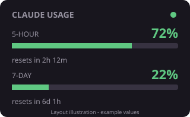

# Claude Usage for Rainmeter

A compact Windows desktop skin showing **used** Claude subscription quota for the 5-hour and weekly windows, with reset times. Independent community project; not affiliated with Anthropic.



Companion: [Codex Usage for Rainmeter](https://github.com/Noppadol1144/rainmeter-codex-usage).

## Requirements

- Windows, PowerShell, and [Rainmeter](https://www.rainmeter.net/).
- Claude Code installed and signed in with an account that supplies subscription usage limits.
- Keep the downloaded repository in a stable local directory; the installed skin refers to its collector scripts.

## Install

Download or clone this repository, extract it, open PowerShell in its directory, and run:

```powershell
powershell.exe -NoProfile -ExecutionPolicy Bypass -File .\Install.ps1 -StatusLine
```

Refresh Rainmeter, then load `ClaudeUsage/ClaudeUsage.ini`. The installer reads Rainmeter's configured Skins directory. For a portable installation, supply `-SkinPath "C:/your/Rainmeter/Skins"`.

`-StatusLine` backs up Claude Code's existing settings and replaces its `statusLine` entry. Other settings are retained. Omit the switch to leave Claude settings unchanged. Restart Claude Code after changing its settings.

## Data sources and limitations

**Status line:** `statusline/statusline.ps1` receives usage fields from Claude Code's [statusLine feature](https://code.claude.com/docs/en/statusline). It updates while Claude Code supplies those fields. A refresh with no usage data keeps previously stored figures.

**Optional background polling:** The poller calls `https://api.anthropic.com/api/oauth/usage` using the access token in the current user's local Claude Code credentials file. This endpoint is **undocumented**: availability, response fields, and permitted use may change. It is not an official integration or an Anthropic API-key billing monitor. The poller backs off after HTTP 429 responses and preserves cached figures on failed reads.

To opt into a local Windows scheduled task that polls every 15 minutes:

```powershell
powershell.exe -NoProfile -ExecutionPolicy Bypass -File .\Install.ps1 -BackgroundPolling
```

Clicking the skin also runs the poller, even without a scheduled task. Avoid repeated clicks during rate limiting. If the task already exists, Windows permissions may require an elevated shell to update it.

Automatic token renewal through `claude -p ok` is **disabled by default**. It would send a real prompt and consume usage. Sign in or run Claude Code yourself when credentials expire. Advanced users can opt in by changing `$AutoRefreshOnExpiry` in `statusline/poll_usage.ps1`.

The reset countdown is calculated when a collector writes data; it is not a continuously ticking clock. If no source returns data, the displayed figures can remain stale. Check `UPDATED`, `STATUS`, and `NOTE` in `skin/usage_status.txt`; the decorative status dot does not certify freshness.

## Local data

Usage snapshots, the poller's raw usage response, backoff state, generated wrapper, and settings backups remain local and are excluded from Git. Credentials are read from Claude Code's own file; the scripts do not copy that file into the project. Do not upload generated data or credentials when reporting issues.

## Uninstall

Unload `ClaudeUsage` in Rainmeter. If background polling was enabled:

```powershell
Unregister-ScheduledTask -TaskName ClaudeUsagePoll -Confirm:$false
```

Restore the backed-up `statusLine` entry in `~/.claude/settings.json`, preserving any other changes made since installation. Remove the installed `ClaudeUsage` skin directory when no longer needed.

## License

MIT. See [LICENSE](LICENSE).
